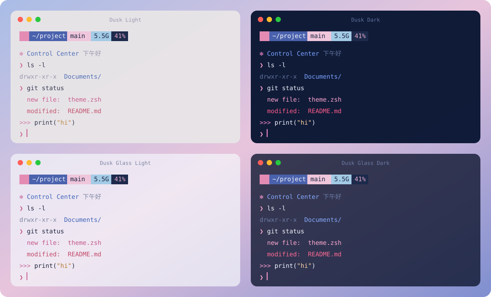

# Dusk 🌸

蓝粉配色的终端全家桶：一明一暗两个 iTerm2 主题、开箱即用的 zsh 环境，加上一套日常和远程快捷命令。macOS 和 Linux 通用。

A blue-and-pink terminal kit: light + dark iTerm2 themes, a ready-to-go zsh setup, and everyday / remote shortcuts. Works on macOS and Linux.



## 安装

```bash
git clone https://github.com/liuxiaZzz/dusk-term.git ~/.dusk
~/.dusk/install.sh
```

安装时会问你两个问题（直接回车就是默认值）：

| 问题 | 选项 |
|---|---|
| 风格 | **经典**：Dusk Light + Dusk Dark，5% 透明 · **玻璃**：Dusk Glass Light + Glass Dark，毛玻璃 |
| 本机和远程 | **分开**：本机浅色，ssh 到服务器自动换深色 · **全深色** · **全浅色** |

也可以直接用参数跳过提问：`--style classic|glass`、`--mode split|dark|light`，或 `-y` 全用默认。

装完新开一个终端（或 `exec zsh`），输入 `dusk` 打开命令面板，所有功能都在里面。

macOS 上再做一步：iTerm2 → **Settings → Profiles** → 选安装结束时提示的配置文件 → **Other Actions… → Set as Default**。

### 和 GCR 或你自己的配置共存

dusk 不会抢已经被占用的命令名：如果 GCR、oh-my-zsh 插件或你自己的 alias 已经定义了 `rm`、`pid`、`gitps` 等，就保留原来的版本，安装界面会列出这些名字，`dusk help` 里也能看到。想改用 dusk 的版本，在 `~/.zshrc` 的 dusk 区块前加一行 `DUSK_OVERRIDE=1`。

GCR 更新只会覆盖它自己的文件，dusk 放在 `~/.config/dusk`，互不影响。

> 建议 clone 到 `~/.dusk`，以后 `dusk update` 就能一键更新。

### 本机和服务器

同一条命令在两边都能用，脚本会自动判断角色：

| | 本机（macOS） | 服务器（Linux） |
|---|---|---|
| iTerm2 主题、远程自动切主题、一键进 tmux | ✓ | – |
| p10k 蓝粉配色、欢迎面板 | ✓ | ✓ |
| shell 环境、日常命令、`listen`、docker 辅助 | ✓ | ✓ |
| 传文件 | `tssh`（拖拽上传） | `trz` / `tsz`、`upload` / `download` |

需要时可以手动指定：`--role local` 或 `--role server`。

### 只装一部分

四个模块可以自由组合：

```bash
~/.dusk/install.sh --modules theme,tools      # 只要主题和日常命令
~/.dusk/install.sh --no-deps                  # 不下载任何依赖（服务器离线时）
~/.dusk/install.sh --themes-only              # 只装 iTerm2 主题
~/.dusk/install.sh --tmux-host me@server      # 一键进服务器 tmux（命令默认叫 st）
```

| 模块 | 内容 |
|---|---|
| `shell` | oh-my-zsh + powerlevel10k + 自动补全建议 + 语法高亮，fzf，zoxide（`j` 跳目录） |
| `theme` | 四个 iTerm2 主题、p10k 蓝粉配色、远程自动切主题、一键进 tmux |
| `tools` | 回收站式 `rm`、git 缩写、磁盘/进程/端口/权限等小工具 |
| `remote` | SSH 端口转发 `listen`、trzsz 拖拽传文件、docker 辅助 |

## 主题

| | |
|---|---|
| **Dusk Light**（浅色） | 雾灰粉底 + 墨蓝字，粉色命令、蓝色目录。 |
| **Dusk Dark**（深色） | 宝石蓝底 + 冷白字，粉点缀，5% 透明。 |
| **Dusk Glass Light**（浅色玻璃） | 冷白毛玻璃，约 38% 透明 + 强模糊，提示栏色块保持实心，像 iOS。 |
| **Dusk Glass Dark**（深色玻璃） | 深宝石蓝烟雾玻璃，约 42% 透明。 |

- 敲 `ssh` / `tssh` / `mosh` 时窗口自动切成 Dusk Dark，退出后切回原来的主题（iTerm2）。
- p10k 提示栏是六种低饱和蓝粉色块，Linux 上只要终端支持真彩色也一样。
- 色板里的"绿色"槽位换成了粉，所以命令高亮、`git status` 新文件都是粉色。

## 控制中心

新标签页会显示一个仿 iOS / macOS 的控制中心，也可以随时输入 `hud` 打开：

- 锁屏风格的大时钟（蓝→粉渐变）、日期、问候
- CPU / 内存 / 磁盘 / 电池磁贴，带 iOS 风格滑条（服务器上自动换成 GPU 或运行时长）
- 工作区（目录、git 分支和改动、conda 环境）和系统信息（主机、IP、ssh 来源）
- 一排常用快捷键胶囊

窄窗口自动变成两列；`hud -c` 是一行精简版。`DUSK_WELCOME=2` 让新标签页只显示精简版，`0` 关闭。

## 只需要记一个命令：`dusk`

直接输入 `dusk`，会弹出命令面板，列出所有功能。装了 fzf 时可以输入几个字筛选（比如"端口""主题""tmux"），回车执行；需要参数的会当场问你。执行后还会提示"下次可以直接输入：……"，用多了自然记住快捷方式。

## 快捷命令

输入 `dusk` 随时查看。

**日常（tools）**

| 命令 | 作用 |
|---|---|
| `rm` / `del <文件>` | 移到回收站，可以恢复（macOS 用系统废纸篓，Linux 用 `~/.local/share/Trash`） |
| `delf <文件>` | 真正删除 |
| `empty_trash` | 清空回收站（会确认） |
| `gita` `gitaa` `gitb` `gitst` `gitl` `gitr` `gitpl` `gitps` | git add / add . / branch / status / log / reset / pull / push 当前分支 |
| `gitc [说明]` | 提交；不带参数会问你 |
| `gitch [分支]` | 切分支；不带参数用 fzf 选 |
| `sz` · `sz <路径> [深度]` | 看磁盘 · 看目录大小（按大小排序） |
| `szn [目录]` | 数文件个数 |
| `pid <关键词>` | 查进程；不带参数且有 NVIDIA 时显示 GPU 进程 |
| `port <端口>` | 谁在监听这个端口 |
| `pathadd <目录> [-s]` | 加到 PATH，`-s` 永久写入 |
| `mychmod` / `mychown <目录> <值>` | 递归改权限 / 所有者（会确认，必要时用 sudo） |
| `ll` `la` `l` `cl` `sc` | 列表（有 eza 时自动用 eza）/ 清屏 / 重新加载 zsh |

**远程（remote）**

| 命令 | 作用 |
|---|---|
| `listen` | 交互式 SSH 端口转发；也可以直接 `listen L 服务器 8888`（本机访问服务器的 8888） |
| `listen R 服务器 3000` · `listen D 服务器 1080` | 远程转发 · socks5 代理 |
| `tssh 服务器` | 带拖拽上传的 ssh（本机；服务器上装了 dusk 就有 trz） |
| `upload` · `download [文件]` | 在服务器上运行，弹出本地文件框上传 / 下载到本地 |
| `dps` · `dsh <容器>` · `dlog <容器>` | docker ps / 进容器 / 看日志 |
| `dockeradd [用户]` | Linux 上免 sudo 使用 docker |
| `st [会话名]` | 一键进服务器的 tmux（iTerm2 原生集成）。服务器、命令名、配色用 `dusk tmux` 设置 |

**shell**

| 按键 / 命令 | 作用 |
|---|---|
| `j <关键词>` | 跳到常去的目录 |
| `Ctrl-R` · `Ctrl-T` · `Alt-C` | fzf 搜历史 · 搜文件 · 跳目录 |
| `x <压缩包>` | 解压任意格式 |
| `Esc Esc` | 给上一条命令加 `sudo` |

**管理**

| 命令 | 作用 |
|---|---|
| `dusk` | 命令面板（所有功能） |
| `hud` | 控制中心 |
| `dusk help` | 速查表 |
| `dusk update` | 拉取最新版并重新安装 |
| `dusk doctor` | 检查依赖是否齐全 |

## 换主题、改设置

装好以后随时可以改，不用重新安装：

```bash
dusk theme                 # 菜单里选风格和本机/远程配色，当前标签页立即生效
dusk theme glass split     # 或者直接说：classic|glass  split|dark|light
dusk tmux                  # 设置一键进 tmux：服务器、默认会话、命令名（st / jt …）、窗口配色
dusk tmux me@server jt     # 或者直接说
dusk tmux off              # 关掉
```

例如"本机浅色玻璃、远程深色玻璃"就是 `dusk theme glass split`。

**一键进 tmux 时，tmux 窗口和网关窗口颜色不一样？** iTerm2 默认让 tmux 窗口用一个单独叫 "tmux" 的配置文件。到 iTerm2 → **Settings → General → tmux**：

- 取消勾选 **Use "tmux" profile rather than profile of the connecting session**，tmux 窗口就会和 `dusk tmux` 选的配色一致，换主题也会跟着变
- 勾选 **Automatically bury the tmux client session after connecting**，连接用的网关窗口会自动藏起来唯一要手动的是 iTerm2 的默认配置文件（新开标签页用哪个）：`dusk theme` 会告诉你该把哪个设为默认。

重新运行 `install.sh` 也会记住你之前的所有选择，只改你这次明确指定的。

这些设置保存在 `~/.config/dusk/config.zsh`。其他开关可以写在 `~/.zshrc` 的 dusk 区块**之前**：

| 变量 | 默认 | 作用 |
|---|---|---|
| `DUSK_MODULES` | 安装时选的 | 例如 `DUSK_MODULES=(theme tools)` |
| `DUSK_SAFE_RM` | `1` | `0` 让 `rm` 恢复原样 |
| `DUSK_OVERRIDE` | `0` | `1` 让 dusk 的命令覆盖已被占用的同名命令 |
| `DUSK_P10K_COLORS` | `1` | `0` 保留你自己的 p10k 配色 |
| `DUSK_SYNTAX_COLORS` | `1` | 输入命令时：拼对蓝色、拼错粉色。`0` 保留原样 |
| `DUSK_WELCOME` | `1` | 新标签页的控制中心：`1` 完整、`2` 精简、`0` 关闭 |

## 安装脚本做了什么

- **shell 模块**：把 oh-my-zsh、powerlevel10k、两个插件 clone 到 `~/.oh-my-zsh`；fzf 装到 `~/.fzf`；zoxide 装到 `~/.local/bin`。缺 zsh/git/curl 时会尝试用 apt/dnf/yum/pacman 安装（需要 sudo）。如果你的 `~/.zshrc` 已经加载了 oh-my-zsh，就不重复加载。
- 没有 `~/.p10k.zsh` 时，复制 powerlevel10k 自带的 rainbow 配置，并套上 Dusk 的布局。
- **remote 模块**：从 GitHub Releases 下载到 `~/.local/bin`：本机下载 tssh，服务器下载 trz / tsz。
- **theme 模块（macOS）**：把两个主题放进 iTerm2 的 DynamicProfiles，实时生效，不碰你已有的配置文件。
- 把 zsh 模块复制到 `~/.config/dusk/`，在 `~/.zshrc` 末尾加一个 `# >>> dusk >>>` 区块（先备份成 `.zshrc.bak-dusk`）。

重复运行是安全的。不会自动改你的登录 shell，如果不是 zsh 会提示你 `chsh` 命令。

## 自己调颜色

主题颜色在 [`build.py`](build.py) 顶部，改完运行：

```bash
python3 build.py && ./install.sh --themes-only
```

p10k 色块在 [`zsh/modules/theme.zsh`](zsh/modules/theme.zsh) 第 1 节。

## 卸载

```bash
~/.dusk/uninstall.sh
```

oh-my-zsh、fzf 等工具会保留，脚本会告诉你它们在哪。

## 致谢

日常与远程命令的思路来自 [GCR](https://github.com/gaojunbin/GCR)（Apache-2.0），这里做了跨平台重写，并去掉了站点专用的功能，详见 [NOTICE](NOTICE)。

## License

[Apache-2.0](LICENSE)
